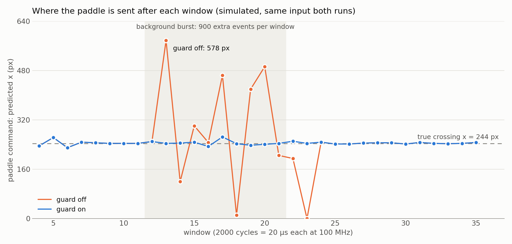
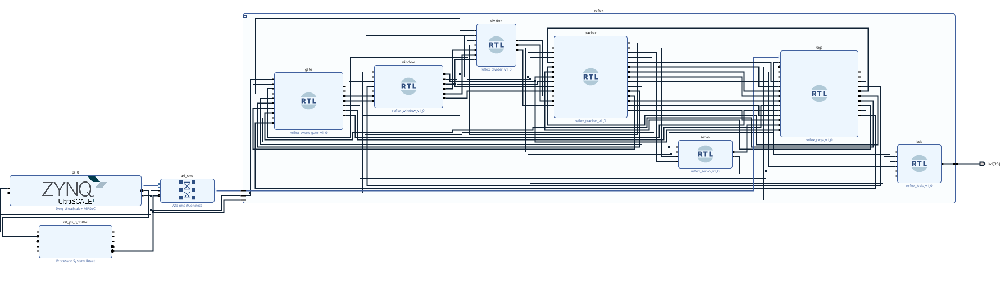
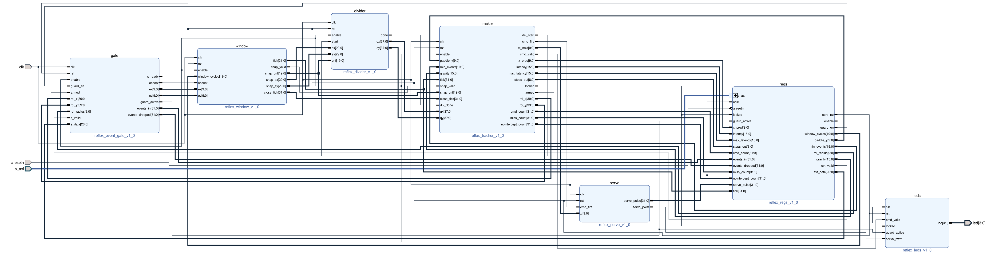
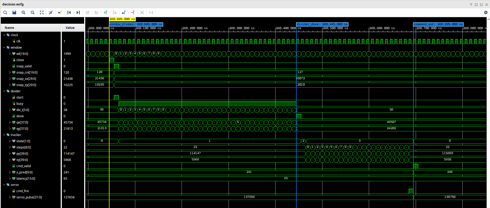
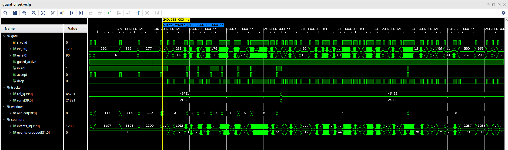
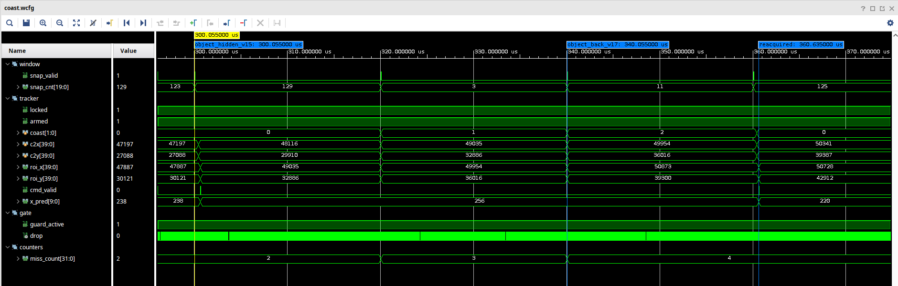
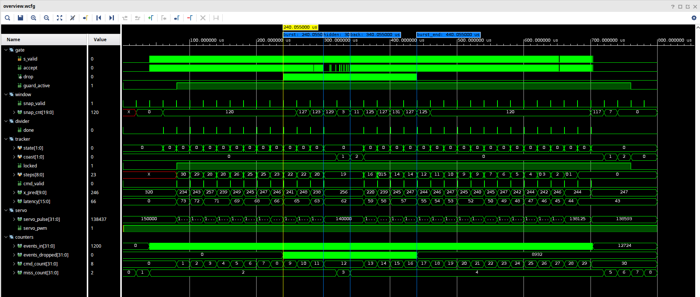
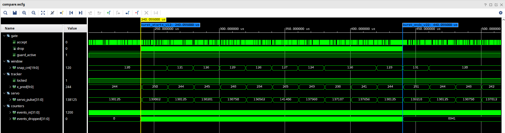
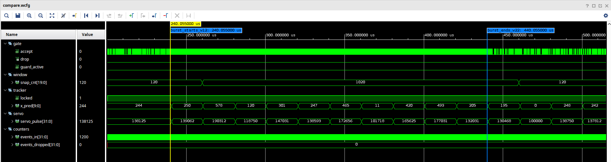

# FPGA reflex: catching a falling object from camera events

A Zynq UltraScale+ design (ZCU104) that reads a stream of event-camera pixels, tracks one
falling object, predicts where it will cross a paddle line and sets a servo command,
all in programmable logic with a fixed, measured compute latency.

The part that matters is what happens when the scene gets busy. A burst of background
events (flicker, other motion) drags a naive centroid tracker off the object. A guard
window around the predicted position keeps the tracker on it, and a short coast carries
the track through windows where the object is hidden.



*Same simulated input in both runs. The shaded windows add 900 background events each.
Guard off: the command swings from 0 to 578 px. Guard on: it stays between 234 and 265 px,
against a true crossing at 244 px.*

## Results (simulation, 100 MHz, 2,000-cycle windows)

| Scenario | Worst prediction error | Notes |
|---|---|---|
| Clean drop | 16 px | last command 247 px vs true crossing 244.0 px |
| Background burst, guard on | 21 px | 8,941 of the 12,967 events dropped by the guard |
| Background burst, guard off | 334 px | same input as the row above |
| Burst + object hidden for 2 windows, coasting on | 24 px | track carried through both hidden windows |
| Same, coasting off | 395 px | |
| Through the AXI register path | 13 px | 100 object events per window, written over AXI4-Lite |

- Compute latency from window close to servo command: 43 to 90 cycles across all
  scenarios (0.43 to 0.90 µs at 100 MHz). It is `43 + steps`, where `steps` is the
  number of one-window predictor steps to reach the paddle line, and the hardware
  measures it from the close tick.
- Error is the paddle command minus the physics truth used to generate the events.
  In every scenario the last command is 247 px, 3 px from the true crossing.

## Architecture



The Zynq PS reaches the design over AXI4-Lite (`M_AXI_HPM0_FPD`, SmartConnect, base
`0xA000_0000`). The `reflex` hierarchy holds seven sub-modules, each a separate Verilog
module kept as its own hierarchy through implementation:

| Sub-module | Job | LUT cells | FFs | DSP |
|---|---|---|---|---|
| `regs` | AXI4-Lite register file, event injection, read-back | 159 | 136 | 0 |
| `gate` | event input and the guard window (accept or drop) | 236 | 64 | 0 |
| `window` | time base, per-window count and coordinate sums | 106 | 229 | 0 |
| `divider` | Q8 centroid x and y, 38-cycle restoring division | 195 | 144 | 0 |
| `tracker` | centroid history, ballistic predictor, lock, coasting | 759 | 566 | 0 |
| `servo` | predicted x to a 1.0 to 2.0 ms servo pulse | 34 | 41 | 1 |
| `leds` | board LEDs: PWM, command, locked, guard active | 49 | 32 | 0 |

LUT cells count LUT primitives; Vivado packs two into one physical LUT where it can.
The whole design uses 1,919 of 230,400 LUTs (0.83%), 2,017 registers and 1 DSP.



### How a decision is made



1. `window` closes a window (2,000 cycles in simulation, 100,000 by default on the
   board, 1 ms) and hands over the count and coordinate sums.
2. `divider` turns them into a Q8 centroid in 38 cycles.
3. `tracker` keeps the last two centroids, takes velocity from them, adds gravity from a
   calibration register and steps the trajectory one window per cycle until it reaches
   the paddle line (at most 255 steps).
4. The crossing x goes to `servo` as a pulse width and to `regs` for read-back. The guard
   window is re-centred on the predicted next centroid.

In the capture above the window closes at 260,045 ns, the divider finishes at
260,445 ns, the predictor takes 22 steps and the command (`x_pred` 248) is out at
260,695 ns: 65 cycles.

### Guard and coasting



When locked, `gate` accepts an event only inside a square of ±24 px around the predicted
centroid; everything else counts as dropped.



When a window has too few events while locked, `tracker` takes the predicted centroid as
that window's measurement and keeps the guard on, for up to two windows. Here the object
is hidden for windows 15 and 16 (3 and 11 events get through the guard), `coast` goes to
1 then 2, and the next real window brings the track back.

### Whole run



| Guard on | Guard off |
|---|---|
|  |  |

## Verification

- **Reference model.** `model/reflex.py` implements the timing contract and integer
  arithmetic in [SPEC.md](SPEC.md) independently of the RTL. The testbench logs every
  window, command and miss; the checker compares the RTL log to the model line by line.
- **Exact match.** Five scenarios, 78 of 78 lines each, including the AXI4-Lite path with
  read-back of every result register.
- **The check sees faults.** Six deliberate RTL breaks (guard off, gravity step removed,
  divider compare, latency off by one, coasting off, AXI read swap): 6 of 6 caught.
- **The block design itself.** The `reflex` hierarchy as Vivado generated it from the
  block design is simulated through its AXI port against the same model (78 of 78 and
  75 of 75 lines). Swapping two nets in that netlist makes the check fail.
- **Implementation.** XCZU7EV, 100 MHz, worst setup slack 4.547 ns, worst hold slack
  0.025 ns, 0 failing endpoints, 0 critical warnings, block design validated.

## Run it

Vivado and XSim 2025.2 on Linux.

```bash
scripts/run_sim.sh          # regression: 5 scenarios vs the model, physics error report
scripts/run_mutants.sh      # six deliberate breaks, each must fail
vivado -mode batch -source scripts/build_bd.tcl   # block design, synthesis, bitstream
scripts/run_bd_sim.sh       # simulate the block design's own reflex netlist
scripts/open_view.sh        # Vivado block design + XSim waveform windows
scripts/capture_waves.sh    # regenerate the waveform figures
python3 scripts/collect_facts.py   # every number above, from the logs, into docs/facts.json
```

## Scope

- Events come from the PS through a register (`EVT_INJECT`), not from a camera.
- The servo pulse drives LED0. A servo needs a PMOD pin; the installed ZCU104 board files
  list no PMOD pins, so none is assigned.
- Not yet run on the board.
- Stimulus is synthetic: a ball with constant horizontal speed under constant gravity,
  120 events per window within 4 px of its centre, and uniform background noise.
- Gravity is a register set by calibration, in pixels per window squared.
- Latency figures are compute only: window close to command. Sensor readout and the
  servo's own motion are outside them.

## Layout

```
rtl/        seven sub-modules + reflex_core / reflex_top wiring wrappers
tb/         tb_core (sensor-rate events), tb_top (AXI4-Lite path, also the BD netlist)
model/      reference model, stimulus generator, checker
scripts/    build, regression, mutants, BD netlist sim, figures, facts
constraints/ ZCU104 LED pins (from the board file)
docs/       figures and facts.json
SPEC.md     timing contract and register map
```
